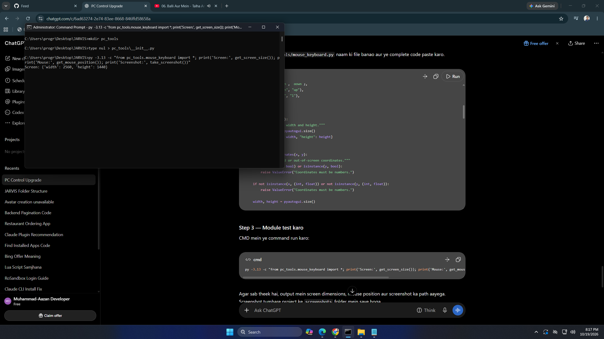

# 🤖 JARVIS — Desktop AI Assistant

> *"Sometimes you gotta run before you can walk."* — Tony Stark

A voice-powered AI desktop assistant for Windows, built with **Groq AI** (LLM + Whisper STT), local PC control, and a sleek dashboard GUI. Speak to it or type — it understands English, Urdu, and Roman Urdu.

---

## ✨ Features

| Feature | Details |
|---|---|
| 🎙️ **Voice Input** | Records mic audio → transcribes via Groq Whisper |
| 🧠 **AI Chat** | Powered by Groq LLM (GPT-4 class model) |
| 🔊 **Text-to-Speech** | Speaks responses using Windows TTS (pyttsx3) |
| 🖥️ **PC Control** | Opens/closes apps & websites via voice/text commands |
| 💾 **Memory** | Remembers last 100 messages across sessions |
| 🌐 **Multi-language** | English, Urdu, Roman Urdu — auto detected |
| 📊 **Dashboard GUI** | Tkinter-based chat window with voice button |

---

## 🗂️ Project Structure

```
JARVIS/
├── JARVIS.py               # Core engine: AI, TTS, voice recording, commands
├── jarvis_dashboard.py     # Tkinter GUI dashboard
├── jarvis_memory.json      # Persistent conversation memory (auto-created)
├── pc_tools/
│   ├── app_control.py      # Open/close approved apps & websites
│   ├── mouse_keyboard.py   # Mouse & keyboard automation
│   └── window_control.py   # Window management
├── model/                  # Vosk offline speech model (fallback)
├── screenshots/            # App screenshots
├── .env                    # 🔒 Your API key goes here (NOT committed to git)
└── .gitignore
```

---

## 🚀 Getting Started

### 1. Clone the repo

```bash
git clone https://github.com/Muhammad-Aazan/Jarvis.git
cd Jarvis
```

### 2. Install dependencies

```bash
pip install groq vosk sounddevice scipy numpy pyttsx3 pyautogui psutil python-dotenv
```

### 3. Get a FREE Groq API Key

1. Go to **[console.groq.com](https://console.groq.com)**
2. Sign up → Create an API key
3. Copy the key

### 4. Create your `.env` file

Create a file named `.env` in the project root:

```env
GROQ_API_KEY=your_groq_api_key_here
```

> ⚠️ **Never share your `.env` file or commit it to GitHub!** It's already in `.gitignore`.

### 5. Run JARVIS

**With GUI Dashboard:**
```bash
python jarvis_dashboard.py
```

**CLI / Terminal mode:**
```bash
python JARVIS.py
```

---

## 🎮 Voice & Text Commands

### 🌐 Websites
| Say / Type | Action |
|---|---|
| `open google` / `google kholo` | Opens Google |
| `open youtube` / `youtube kholo` | Opens YouTube |
| `open github` / `github kholo` | Opens GitHub |
| `open gmail` / `gmail kholo` | Opens Gmail |
| `open chatgpt` | Opens ChatGPT |

### 🖥️ Apps
| Say / Type | Action |
|---|---|
| `open notepad` / `notepad kholo` | Opens Notepad |
| `open calculator` / `calculator kholo` | Opens Calculator |
| `open vscode` | Opens VS Code |
| `open explorer` / `folder kholo` | Opens File Explorer |
| `open cmd` / `terminal kholo` | Opens Command Prompt |
| `open task manager` | Opens Task Manager |

### 🔧 Utility
| Say / Type | Action |
|---|---|
| `what time` / `time batao` | Tells current time |
| `what date` / `aaj ki date` | Tells today's date |
| `volume up` / `awaaz barhao` | Increases volume |
| `volume down` / `awaaz kam karo` | Decreases volume |
| `mute` / `sound band karo` | Mutes audio |
| `show desktop` / `desktop dikhao` | Shows desktop |
| `clear chat` / `chat clear karo` | Clears chat history |

### 💬 AI Chat
Anything else → sent directly to **Groq LLM** for intelligent response!

---

## ⚙️ Configuration

Edit these values at the top of [`JARVIS.py`](JARVIS.py):

```python
MIC_DEVICE      = 1       # Change to your mic device index
MIC_SAMPLE_RATE = 44100   # Sample rate (Hz)
RECORD_SECONDS  = 6       # Recording duration per voice press
```

> Run `python mic_devices.py` to list available microphone device indices on your system.

---

## 🛠️ Tech Stack

- **[Groq](https://groq.com)** — Ultra-fast LLM inference + Whisper transcription
- **[Vosk](https://alphacephei.com/vosk/)** — Offline speech recognition (fallback)
- **[pyttsx3](https://pypi.org/project/pyttsx3/)** — Windows Text-to-Speech
- **[sounddevice](https://python-sounddevice.readthedocs.io/)** — Mic audio recording
- **[SciPy](https://scipy.org/)** — Audio resampling
- **[Tkinter](https://docs.python.org/3/library/tkinter.html)** — GUI Dashboard
- **[pyautogui](https://pyautogui.readthedocs.io/)** — Keyboard/mouse automation
- **[psutil](https://psutil.readthedocs.io/)** — Process management

---

## 📸 Screenshots

<p align="center">
  
</p>

---

## 📄 License

MIT License — feel free to use, modify, and build upon this project.

---

<p align="center">Made with ❤️ by <a href="https://github.com/Muhammad-Aazan">Muhammad Aazan</a></p>
